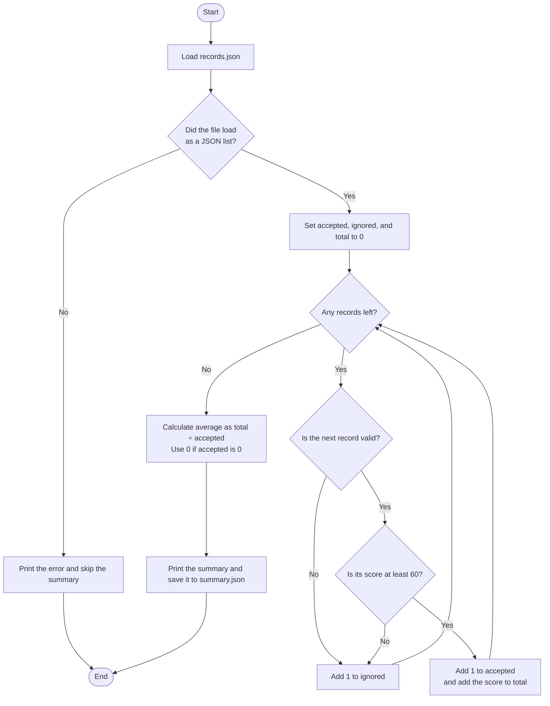

# Record Analyzer

[](https://opensource.org/licenses/MIT)
[](https://www.python.org/downloads/)

A robust Python application for analyzing and summarizing course records from JSON files. The analyzer validates record integrity, filters scores based on configurable thresholds, and generates statistical summaries.

## Features

- **Data Validation**: Ensures course records meet structure and type requirements
- **Score Filtering**: Accepts only records with scores of 60 or higher
- **Statistical Analysis**: Calculates totals, averages, and record counts
- **JSON Export**: Saves summary results to `summary.json`
- **Zero Dependencies**: Pure Python implementation with no external packages required

## Installation

Clone the repository:

```bash
git clone https://github.com/vinay12345678910/record-analyzer.git
cd record-analyzer
```

No additional dependencies are required. The script uses only Python standard library modules.

## Usage

### Running the Analyzer

Execute the main script from the project directory:

```bash
python3 record_analyzer.py
```

The script will:
1. Read course records from `records.json`
2. Validate each record's structure and data types
3. Filter records with scores ≥ 60
4. Display summary statistics (accepted count, ignored count, total score, average)
5. Save results to `summary.json`

### Input Format

The `records.json` file should contain an array of course records:

```json
[
  {"course": "Mathematics", "score": 85},
  {"course": "Physics", "score": 72},
  {"course": "Chemistry", "score": 55}
]
```

### Output

Console output example:
```
Accepted: 2
Ignored: 1
Total Score: 157
Average: 78.5
```

Generated `summary.json`:
```json
{
  "accepted": 2,
  "ignored": 1,
  "total": 157,
  "average": 78.5
}
```

## Record Analyzer Flowchart



## Validation Rules

Each record must satisfy the following criteria:

- **Structure**: Must be a dictionary with `course` and `score` keys
- **Course Name**: Non-empty string
- **Score**: Numeric value (integer or float) between 0 and 100 inclusive
- **Threshold**: Score must be ≥ 60 to be accepted

Invalid records are counted as ignored and excluded from calculations.

## Testing

Run the test suite to verify functionality:

```bash
python3 -B test_practice.py
```

The test suite checks four cases:
- Summary calculation for scores above and below the cutoff
- Missing file returns `None`
- Malformed JSON returns `None`
- A valid JSON file containing `[]` returns an empty list

The missing-file and malformed-JSON tests print `File not Found` and `Invalid JSON` during a passing run.

## Project Structure

```
record-analyzer/
├── record_analyzer.py    # Main application logic
├── test_practice.py      # Test suite
├── records.json          # Sample input data
├── summary.json          # Generated output
├── README.md             # Project documentation
└── LICENSE               # MIT License
```

## Requirements

- Python 3.x
- No external dependencies

## Contributing

Contributions are welcome! Please feel free to submit a Pull Request.

## License

This project is licensed under the MIT License - see the [LICENSE](LICENSE) file for details.

## Author

**Vinay**

---

*Built with Python | Designed for simplicity and reliability*
